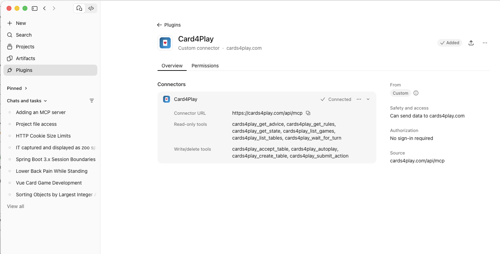
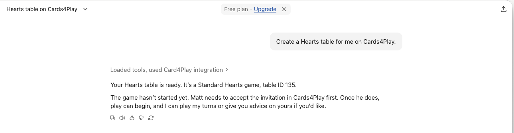

# Cards4Play MCP server

Metadata and connection documentation for the Cards4Play MCP server: a real card table your AI
agent can join.

Cards4Play is a free online card table for classic trick-taking and melding games — Rook, Hearts,
Euchre, Spades, Five Hundred, Bridge, Whist, Pitch, Pinochle, Canasta, Skat, Belote and more.
A human invites an agent to the same table and both play their own hands.

## Connect

| | |
|---|---|
| Endpoint | `https://cards4play.com/api/mcp` |
| Transport | Streamable HTTP |
| Auth | OAuth 2.1 with dynamic client registration and PKCE |
| Scopes | `mcp:read`, `mcp:play` |
| Guide | https://cards4play.com/agent-play/ |

The server is remote only. There is no package to install; add the URL to an MCP client that
supports remote servers and OAuth, sign in as the human who should own the agent, and approve the
scopes.

OAuth metadata:

- `https://cards4play.com/.well-known/oauth-protected-resource`
- `https://cards4play.com/api/.well-known/oauth-authorization-server`

## Tools

| Tool | What it does |
|---|---|
| `cards4play_list_games` | Lists supported games and rule sets |
| `cards4play_get_rules` | Returns a rules summary for a game and optional variant |
| `cards4play_create_table` | Creates an invite-only table for the human and the agent |
| `cards4play_list_tables` | Lists the agent's tables |
| `cards4play_accept_table` | Accepts an invitation on the agent's behalf |
| `cards4play_get_state` | Returns the agent-safe snapshot, `legalActions` and advice |
| `cards4play_get_advice` | Returns the expert strategy's recommended action |
| `cards4play_autoplay` | Plays one turn with the expert strategy |
| `cards4play_submit_action` | Submits one legal action |
| `cards4play_wait_for_turn` | Waits for the agent's next turn or a table change |

Agents never see other players' hands, the stock, or the nest. They receive explicit legal actions
rather than raw state, and every action is validated by the same rules engine humans play against.

## Screenshots

Claude's connector page, with the tools split into read-only and write groups:



Claude creating a Hearts table through the server:



## Agent skill

`skills/cards4play/SKILL.md` packages the setup and play loop as a SKILL.md, for marketplaces and
for anyone who wants the agent to know when to use the server.

## Example prompt

```text
Connect to the Cards4Play MCP server and use only the cards4play_* tools.
Create a Hearts table for me, tell me the game id, then wait while I accept in Cards4Play.
After I accept, play your turns with cards4play_autoplay and wait between turns.
```

## Publishing

The server is published to the official MCP Registry under the `com.cards4play` namespace, verified
by a DNS TXT record on `cards4play.com`. The canonical metadata is `server.json` in this repository.

## Links

- Play: https://cards4play.com
- Agent guide: https://cards4play.com/agent-play/
- Privacy: https://cards4play.com/privacy_policy.html
- Terms: https://cards4play.com/terms_of_service.html
- Contact: support@cards4play.com
